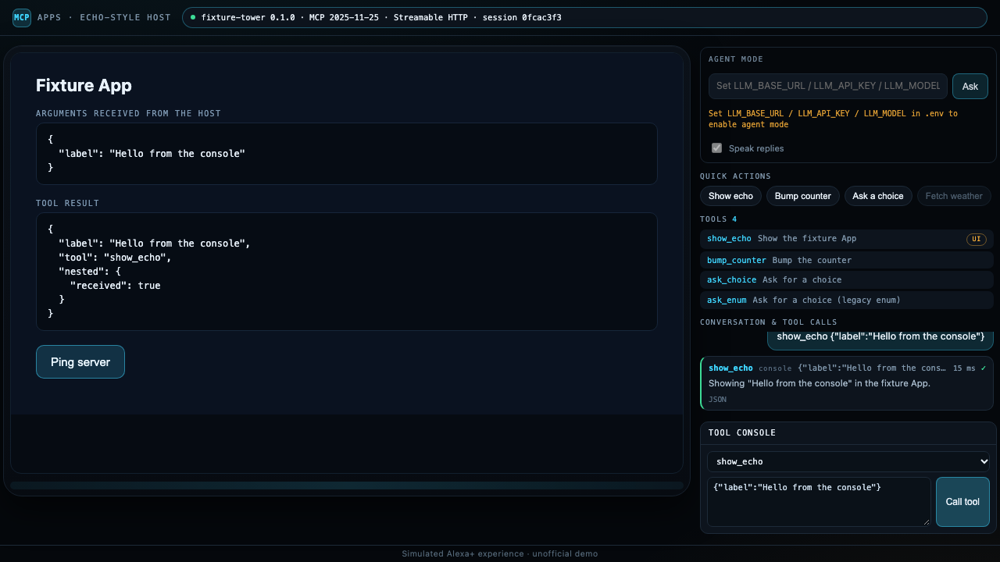

# echo-mcp-apps-sim

**An Echo Show–style web host for testing MCP servers.** Point it at any MCP
server that speaks Streamable HTTP and you get a 1280×720 smart-display frame
that is a real MCP client: it lists and calls tools, renders MCP Apps in a
sandboxed iframe, answers `elicitation/create` with tappable cards, and can let
an OpenAI-compatible model drive the tools in agent mode.



## Why this exists

Voice-first assistants increasingly talk to MCP servers, and MCP Apps put a real
UI on the glass: a board, a checklist, a map. Building one is easy to get wrong
because most MCP clients show you JSON, not a screen — you cannot see whether
your App's `sendToolResult` ever arrived, whether the sandbox CSP blocks your
font, or whether your elicitation schema renders as two buttons or as an empty
card.

The official simulators for voice assistants are not generally available, so
there is a gap: **there was no open, product-neutral web host where any MCP
server author could watch their App and their elicitation flow work.** This is
that host. It is small, it is honest about what it does, and it is a real
protocol client — not a mock.

## Quick start (30 seconds)

```bash
git clone https://github.com/hanshou101/echo-mcp-apps-sim.git
cd echo-mcp-apps-sim
npm install
npm run build
npm run demo          # bundled example MCP server + the host, both in this terminal
```

Open <http://127.0.0.1:8180>. The example server listens on `127.0.0.1:3301`,
the page on `8180`, the App sandbox on `8181`. Click **Show echo** to see an MCP
App render, **Ask a choice** to answer an elicitation, or open **Tool console**
to call any tool with your own JSON. `Ctrl-C` stops both processes.

Node 20.19 or newer is required. `npm run demo` is a bash script; on Windows,
start the two halves in two terminals instead:

```bash
npx tsx test/fixtures/fixture-server.ts       # terminal 1 — example server on 3301
npm start                                      # terminal 2 — host on 8180
```

## Connect your own MCP server

```bash
MCP_URL=http://127.0.0.1:3001/mcp npm start
```

Because the MCP client runs in the browser, your server must:

- answer CORS for the page origin (`http://127.0.0.1:8180`),
- expose the `Mcp-Session-Id` response header (`Access-Control-Expose-Headers`)
  and allow the `mcp-session-id`, `mcp-protocol-version`, `last-event-id`,
  `content-type`, `authorization` request headers,
- implement Streamable HTTP with `tools`, and
- serve an App as `resources/read` of a `ui://…` resource with MIME type
  `text/html;profile=mcp-app` if you want a rendered UI.

The bundled example server (`test/fixtures/fixture-server.ts`) is a ~200 line
reference for all of the above, including the CORS headers the browser needs.

## What it supports

| Capability | How it shows up |
| --- | --- |
| **Streamable HTTP, stateful sessions** | The badge reads `server version · MCP <negotiated> · Streamable HTTP · session <first 8>`, straight from `initialize` and the response headers. |
| **MCP Apps** | A tool result that references a `ui://` resource is mounted in a double-iframe sandbox (`AppBridge`, separate origin on `SANDBOX_PORT`). The App receives the tool input and result, and its own `tools/call` requests are forwarded through the host and logged. |
| **Elicitation (form)** | `elicitation/create` becomes a card over the screen: the server's message plus one large button per option. Both the 2025-11-25 titled enum (`oneOf: [{const, title}]`) and the legacy `enum` + `enumNames` schema render. |
| **Direct mode** | Quick-action chips and a tool console call real tools with no model involved. Chips come from `presets.json`. |
| **Agent mode** | Point it at any OpenAI-compatible endpoint and the model drives the tools through a bounded tool loop, while elicitation is still answered by the person clicking. Replies can be spoken with the browser's `speechSynthesis`. |
| **Demo clock** | If the server answers `GET /demo/clock`, a clock control appears; setting it `POST`s `{time}` and replays the last quick action, so a demo can walk through an afternoon in a minute. |
| **Tool-call log** | Every call — chip, console, App, agent, clock — is logged with name, arguments, duration, ✓/✗ and the expandable raw JSON. |

## Configuration

| Variable | Default | Meaning |
| --- | --- | --- |
| `MCP_URL` | `http://127.0.0.1:3301/mcp` | Streamable HTTP endpoint of the server under test. |
| `SIM_PORT` | `8180` | Port for the page and `/api/*`. |
| `SANDBOX_PORT` | `8181` | Port for the App sandbox proxy (must be a different origin). |
| `PRESETS_FILE` | `presets.json` | Quick-action chips. |
| `SKILL_FILE` | `skills/SKILL.md` (optional) | Skill text appended to the agent system prompt; `skills/SKILL.example.md` is a template. |
| `LLM_BASE_URL`, `LLM_API_KEY`, `LLM_MODEL` | — | OpenAI-compatible endpoint for agent mode. Read only by the host server, never sent to the browser. |

`GET /api/config` returns `{mcpUrl, sandboxUrl, agent, skill}` so the page knows
where to connect; `GET /api/presets` returns the validated chip list.

## Quick actions (`presets.json`)

```json
{
  "presets": [
    { "id": "echo", "label": "Show echo", "tool": "show_echo", "args": { "label": "Hello" } },
    { "id": "bump", "label": "Bump counter", "tool": "bump_counter", "args": {} }
  ]
}
```

Each chip runs a real `tools/call` with `args`. A chip whose tool the connected
server does not expose is greyed out (`Server has no <tool> tool` in its
tooltip), so one file can be pointed at several servers. A malformed file is
reported in the page and in the server log instead of silently producing an
empty panel. `id`, `label` and `tool` are required; `args` defaults to `{}`.

## Agent mode

Set the three `LLM_*` variables and the input at the top right turns on. The
system prompt is composed of, in order: the configured skill file (frontmatter
stripped), the MCP server's own `instructions`, and one fixed persona sentence.
The model gets the server's tools as OpenAI function definitions and has at most
six tool rounds per turn. Tool results are compacted before going back to the
model: the text block plus `structuredContent` with bulky keys removed and each
step trimmed to `stepId` / `start` / `end` / `status`.

With no LLM configured the input stays disabled and says exactly what to set —
direct mode keeps working. Nothing pretends to be a model.

## Tests

```bash
npm run test:unit    # vitest: elicitation schema parsing, presets file, prompt, tool loop
npm run test:e2e     # playwright, headless; starts the example server and the host itself
npm test             # build + unit + e2e
```

The E2E suite is the honest proof that this is a real client and host: it
connects over Streamable HTTP, checks the negotiated protocol and session id,
lists tools, calls one through the console, asserts the App rendered **inside the
iframe** (DOM text, not a screenshot), clicks a button inside the App and sees
the forwarded `tools/call`, answers both elicitation schema shapes, checks the
demo clock appears only when the server exposes it, and drives agent mode
through a scripted OpenAI-compatible endpoint. Screenshots land in `docs/`.

E2E is always headless and never steals focus.

## Limits

- **Streamable HTTP only.** No SSE fallback, no stdio servers; the client runs in
  the browser.
- **No voice input.** Text in, speech out. The "Echo" is a screen and a
  microphone-free input box.
- **Not the official simulator.** No Alexa account, no real device, no Amazon
  services. The footer says "Simulated Alexa+ experience · unofficial demo" and
  no Amazon logos are used.
- **Apps run in an iframe.** Sandbox rules follow the MCP Apps spec; a strict
  CSP on your App's resources can still block things the page cannot fix for you.
- **One host page, one server.** No multi-user sessions, no persistence between
  restarts beyond what your server keeps.

## Attribution and license

MIT. The sandbox architecture, the sandbox relay and the AppBridge host sequence
are adapted from the official MCP Apps examples in
[`modelcontextprotocol/ext-apps`](https://github.com/modelcontextprotocol/ext-apps)
(MIT); see `NOTICE.md` for the file-by-file list. Echo Show and Alexa are
trademarks of Amazon.com, Inc.; this project is not affiliated with Amazon.
